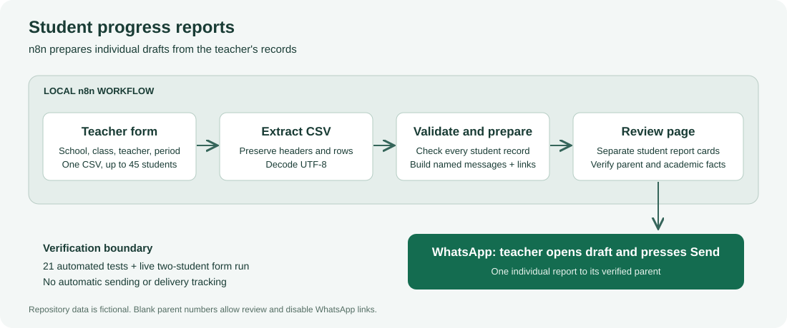
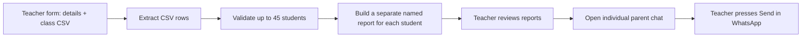

# Student reports with n8n and standard WhatsApp

**College project · n8n + JavaScript + CSV · Up to 45 students per batch**

[](https://github.com/shivraaj98/students-report/actions/workflows/verify.yml)

This workflow prepares individual progress messages for a class of **up to 45 students**, using the teacher's homework records, exam results, and concerns. Each message includes the student's name and opens the correct parent's WhatsApp chat with the message prefilled.

**You press Send in each WhatsApp chat.** Opening a link does not send a message, and this workflow cannot tell whether a message was sent, delivered, or read. No WhatsApp premium subscription, paid WhatsApp API, or AI model is used for this workflow. n8n's self-hosted Community edition is free; running on your own computer avoids cloud hosting fees. Normal internet costs apply.

## Documentation and college submission

| File | Purpose |
| --- | --- |
| [Project report (PDF)](docs/PROJECT_REPORT.pdf) | Printable college project report. |
| [Project report (Markdown)](docs/PROJECT_REPORT.md) | Editable report with clearly marked student and college fields. |
| [Project report (HTML)](docs/PROJECT_REPORT.html) | Browser-readable report; use Print to save a PDF. |
| [Architecture](docs/ARCHITECTURE.md) | Components, data flow, validation, and design decisions. |
| [User guide](docs/USER_GUIDE.md) | Installation, first run, CSV preparation, and troubleshooting. |
| [Testing and results](docs/TESTING.md) | Automated coverage, observed live execution, and remaining checks. |
| [Demonstration and viva](docs/DEMO_AND_VIVA.md) | Presentation outline, demo script, and viva questions. |

Fill in the name, roll number, college, course, supervisor, and academic year in the editable report before submission. No supervisor approval, signature, or student identity has been invented.



## Workflow



The importable workflow is **student-reports.n8n.json**. It uses n8n's built-in Form Trigger, Extract from File, Code, and Form Ending nodes. There are no community nodes or external account credentials to configure.

## Start n8n

Clone the repository if you have not already downloaded it:

```powershell
git clone https://github.com/shivraaj98/students-report.git
cd students-report
```

Use your existing n8n instance, or install Docker Desktop. If installation enables WSL or Virtual Machine Platform, restart Windows first. Open Docker Desktop and wait for its engine to start, then run this from the project folder:

```powershell
docker compose up -d
```

Open **http://localhost:5678** and create your local n8n owner account. The supplied Compose file binds the service to this computer and keeps n8n's database in the `n8n_data` Docker volume. It pins n8n 2.43.7. Stop it with `docker compose stop` when finished.

The workflow was successfully imported, enabled, and executed on a local Docker-hosted n8n **2.43.7** instance on **17 October 2026**. Uploading `examples/students.csv` generated two separate reports with the expected student, parent, homework, and exam details. Both example phone numbers are blank, so that run produced no WhatsApp links and sent no messages. See [Testing and results](docs/TESTING.md) for the evidence and limits of verification.

Node.js 22 or newer runs this repository's dependency-free builder and tests. Docker supplies n8n's own runtime; you do not need to install the n8n npm package on your host.

## Import and use

1. In n8n, create a workflow and choose **Import from File** from the workflow menu.
2. Select `student-reports.n8n.json` and save the workflow.
3. Choose **Execute Workflow**, then open the teacher form's Test URL if the form does not open automatically.
4. Enter the school, class, teacher, and reporting period. Upload `examples/students.csv` to try the example, or your own CSV prepared from that template.
5. Submit the form. It displays a separate message for each student, showing that student's name, ID, parent, and phone number.
6. Select **Open WhatsApp for [student]**, verify the parent and message, then press **Send** in WhatsApp. Repeat for the next student. On a computer, sign in to WhatsApp Web if prompted.

For later batches, run the form again with the new records and reporting period. To reuse the same form address without starting a test execution each time, save and publish/activate the workflow and use the Form Trigger's Production URL. On a remotely hosted n8n instance, protect the teacher form with the trigger's Basic Auth option before using real records.

The complete class preview is for the teacher. Send only the individual messages to parents.

You can open `examples/report-preview.html` directly to see an offline example. Its parent numbers are deliberately blank, so it cannot open a parent chat. The workflow's generated review page can also be printed or saved from the browser.

## Prepare the CSV

Use **one row per student**, with at most 45 student rows, and export **CSV UTF-8** from your spreadsheet. Keep phone numbers as text with their full country code; the workflow never guesses a country code. Replace the example records with your own class records.

| Column | What to enter |
| --- | --- |
| `student_id` | Required unique ID or roll number. Keep it consistent between reports. |
| `student_name` | Required student's name. |
| `parent_name` | Parent or guardian name; optional. |
| `parent_phone` | Full international WhatsApp number, such as `+<country code><number>`. A blank cell allows a preview but disables the link. |
| `homework_completed` | Number of assignments completed for this reporting period. |
| `homework_assigned` | Total assignments assigned for the same period. |
| `exam_results` | Recorded results, such as `Mathematics: 38/50; English: 42/50`. Semicolons or line breaks separate subjects. |
| `teacher_concerns` | Specific recorded observations or concerns. Enter `None reported.` only when that is what the teacher has recorded. |
| `parent_action` | Support requested from the parent; optional. |

The header row must include all columns except `parent_name` and `parent_action`, which may be omitted. Cells for homework, results, and concerns may be blank. Blank information is reported as **Not recorded**, without inventing results or assuming there are no concerns.

Both homework counts must be present together or blank together. Counts must be nonnegative whole numbers; completed homework cannot exceed assigned homework. Enter `0,0` when no homework was assigned. Duplicate student IDs, duplicate headers, misspelled headers, invalid nonempty phone numbers, malformed rows, and classes over 45 stop the batch for correction. Different students can share a parent number; the review page highlights that case.

Student names, IDs, and parent names are limited to 120 characters; results, concerns, and parent actions to 1,000 each. Phone format checks cannot establish whether a number belongs to the intended parent or has a WhatsApp account; verify the recipient in WhatsApp.

## Example message

```text
Student progress report

Example School
Class: 6 A
Period: Example week

Dear Parent One,

Student: Aarav (example)
Student ID: STU001

Homework
Completed 4/5 assignments. Pending: 1.

Exam results
Mathematics: 38/50
English: 42/50

Teacher concerns
One homework assignment is pending.

Parent support requested
Please help complete the pending assignment by Friday.

Regards,
Example Teacher
Class teacher
```

## Why this uses n8n without RAG

The facts are already structured in the CSV. Directly mapping each row to its own parent message keeps marks, homework counts, and student identities exact and avoids model costs. RAG would become useful if the records were instead spread across lesson notes or documents that needed to be searched. It is unnecessary for this version.

This version automates preparing and addressing the reports. It leaves the final sending step in standard WhatsApp using its official click-to-chat links. Fully unattended sending would require a different integration; the official WhatsApp Business Platform is separate from a premium app subscription and has its own setup and pricing.

## Development and verification

No npm installation is needed for the builder or tests:

```powershell
node scripts/build-workflow.js
node --test
```

`src/report-engine.js` is embedded into the workflow by the builder. Rebuild `student-reports.n8n.json` after changing the engine. All **21 automated tests pass**, including student-to-parent mapping for 45 students, validation, Unicode message links, HTML escaping, and execution of the exact exported Code node with n8n-shaped inputs. The actual hosted form, CSV extraction, Code node, and completion page also passed the two-student example run. Sending to real WhatsApp recipients remains untested.

To regenerate the browser-readable college report after editing its Markdown source:

```powershell
node scripts/build-report.js
```

Open `docs/PROJECT_REPORT.html` and print to PDF, or use `node scripts/build-report.js --pdf` if Chrome or Edge is installed. Report rendering uses Node.js built-in modules and a local browser; it does not upload the report to a document conversion service.

## Push changes from VS Code

Open the project folder in VS Code. The settings in `.vscode/settings.json` enable Git, automatic fetching, GitHub sign-in, and push success notifications.

1. Open **Source Control** with **Ctrl+Shift+G**.
2. Review the changed files and select **+** to stage the files you want to upload.
3. Enter a commit message and select **Commit**.
4. Choose **Push** from the Source Control **...** menu, or select **Sync Changes** to pull and push. Review the sync confirmation before continuing.
5. If GitHub requests authentication, sign in as **shivraaj98**.

In this configured working copy, `origin` points to `https://github.com/shivraaj98/students-report.git`, and `main` is configured to push there. The original project remote is retained as `upstream`. Commit identity and the preferred GitHub username are stored in this working copy's local Git configuration; passwords and tokens do not belong in workspace settings.

You can also commit and push from VS Code's terminal:

```powershell
git status
git add .
git commit -m "Describe your changes"
git push
```

Check the destination with `git remote -v`. If Git tries the wrong GitHub account, run `git credential-manager github login --username shivraaj98` in the terminal, complete sign-in, and retry `git push`. This saves the account in Windows Credential Manager without removing other accounts.

## Project structure

```text
.
├── student-reports.n8n.json   # Importable n8n workflow
├── compose.yaml               # Local n8n container and persistent volume
├── src/report-engine.js       # Validation, messages, links, and review HTML
├── scripts/build-workflow.js  # Workflow and offline preview generator
├── scripts/build-report.js    # College report HTML/PDF generator
├── tests/report-engine.test.js
├── examples/students.csv      # Fictional records; phone numbers are blank
├── examples/report-preview.html
└── docs/                      # Report, diagrams, guides, and test record
```

## Student data and repository contents

Only fictional example records belong in this repository. Store real class CSV files and exports under `private/`, which Git ignores, and keep n8n credentials and execution data out of commits. The `.runtime/`, `.n8n/`, `.env`, and log paths are also ignored. n8n keeps its local database and configuration in the Docker volume rather than the source tree.

The project export is intentionally inactive and contains no account credentials. Importing the JSON into another n8n instance does not publish a form automatically.

GitHub Actions rebuilds the workflow and report HTML, runs the test suite on Node.js 22 and 24, and checks that generated files match their sources. PDF generation uses a local browser and is separate from CI.

## References

- [WhatsApp: official click-to-chat and prefilled messages](https://faq.whatsapp.com/5913398998672934)
- [n8n: self-hosted editions, including free Community](https://docs.n8n.io/hosting/community-edition-features/)
- [n8n: Form Trigger](https://docs.n8n.io/integrations/builtin/core-nodes/n8n-nodes-base.formtrigger/)
- [n8n: Form node and completion pages](https://docs.n8n.io/integrations/builtin/core-nodes/n8n-nodes-base.form/)
- [n8n: Extract from File](https://docs.n8n.io/integrations/builtin/core-nodes/n8n-nodes-base.extractfromfile/)
- [n8n: Docker Compose installation](https://docs.n8n.io/deploy/host-n8n/install-options/install-using-docker-compose.md)
- [n8n npm package metadata, including runtime requirements](https://registry.npmjs.org/n8n/latest)
