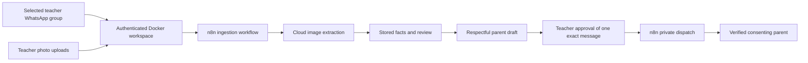

# ClassBridge photo automation

This Docker installation is a shared teacher workspace for **one class and one WhatsApp group**, with up to 200 student records. It reads teacher photos and text, keeps the supporting records, and prepares respectful individual parent updates. Teachers approve each complete message and recipient before n8n can send it privately through the linked teacher account.

## Start and open the workspace

Install Node.js 22 or later and Docker Desktop, then start Docker Desktop. From this repository:

```powershell
npm run automation:setup
npm run automation:start
npm run automation:open
```

The setup command generates private random keys in the ignored `.env` file. The launcher opens a private setup link without printing its secret. Create the administrator password, using at least 10 characters. The administrator username is `admin`. Subsequent visits use **http://localhost:8787**. n8n remains local at **http://localhost:5678**; its owner login is separate from the teacher login.

The initial image build downloads Chromium and can take several minutes. The existing `n8n_data` volume is retained. Three ClassBridge workflows import and publish at n8n startup; existing workflows remain in place. Keep the same project directory and Docker project name to reuse the same volumes.

## Give teachers a temporary HTTPS address

```powershell
npm run automation:share
```

The command starts Cloudflare Quick Tunnel, configures the exact public origin, rebuilds the app if necessary, and checks that class records require login. It prints a temporary HTTPS address and saves it to the ignored `.runtime/automation-share.json`. Share the address with teachers after creating their accounts in **Connections → Add teacher login**. Give passwords through your school's normal secure channel.

For initial administrator setup using that HTTPS address on this computer:

```powershell
npm run automation:open -- --shared
```

Keep this computer awake, connected to the internet, and Docker running. The address can change when the tunnel restarts; rerun `automation:share` to refresh the configured origin and address. Quick Tunnels have no uptime guarantee and suit temporary testing. A permanent school installation needs an always-on host and a named HTTPS tunnel or reverse proxy. See [Cloudflare's Quick Tunnel documentation](https://developers.cloudflare.com/tunnel/get-started/quick-tunnels/).

## One-time connections

1. Open **Connections** as administrator. Acknowledge use of the teacher-owned account and the unofficial connector notice, then choose **Link teacher WhatsApp**. On the teacher phone, open WhatsApp **Linked devices → Link a device** and scan the displayed QR. The QR and saved session stay behind teacher/admin authentication.
2. Load the teacher's groups and select this class group. Member numbers import when WhatsApp makes them available. Select the teacher numbers whose group posts may supply class records, then save settings. Private report recipients must be individual group contacts. An unavailable number is left unavailable; opaque WhatsApp IDs are never treated as phone numbers.
3. Connect an **OpenAI API account** in the vision form, confirm authorization to process these school documents in the cloud, and save. An API account with billing and model access is required; a ChatGPT subscription does not supply API billing. The default image-capable model is `gpt-4.1-mini`. The app checks model access and encrypts the key at rest. Enter the key only in the dashboard, never in chat or GitHub. Image extraction uses the Responses API with structured output and `store: false`; provider retention and billing policies still apply. See [image input documentation](https://platform.openai.com/docs/guides/images-vision) and [API data controls](https://platform.openai.com/docs/guides/your-data).
4. Upload a clear **class roster photo** showing student names and roll numbers once. Choose **Class roster**, or use automatic detection. Review unclear extracted records. Roster phone numbers are suggestions, never proof of identity or consent.
5. In **Students & parents**, choose each student's parent from the imported group contacts, verify the relationship against school records, and record evidence of the parent's existing permission or private reply. This match is stored for later reports. Correct a student's spelling here if necessary. The app cannot safely infer which child belongs to a group member merely from a name or number.

The connector uses [whatsapp-web.js](https://wwebjs.dev/), which is unofficial and may stop working or lead to WhatsApp account restrictions. The administrator acknowledges this before linking. It is configured only for the selected class group and the teacher numbers chosen for ingestion.

Parents may privately send the linked teacher account:

```text
PARENT STU001 | Student Name | I AGREE
```

This creates a suggested match for an existing student if the sender belongs to the group. The administrator must still verify it. No registration or invitation messages are sent automatically. A private `STOP` reply removes the parent's permission and blocks pending reports.

## Daily teacher use

- Teachers post diary, homework, complaint, test, or exam **photos/text in the selected group**, or sign in to the dashboard and upload them from their phones. Group ingestion begins with new posts after linking and configuration; the connector does not bulk import chat history. A caption can help identify the student or category.
- The vision service extracts names, roll numbers, dates, marks, homework counts, and supporting quotes. It does not guess completion from an assignment announcement. Exact student matches can be accepted automatically; unclear matches, contradictory marks, roster entries, and teacher concerns require review. A class-wide diary or assignment applies to the roster present at ingestion. Add the roster first.
- **Photo inbox → View / review** displays the original source beside extracted facts. Confirm uncertain records, correct accepted records, or exclude incorrect ones. Clear photos with visible student identifiers work best. JPG, PNG, WebP and UTF-8 text are supported, up to 10 MB each; PDF, audio, video, and arbitrary documents are not supported.
- Drafts update when records or parent details change; a daily n8n schedule also prepares drafts at **18:00 Asia/Kathmandu**. The default report window is seven days and can be changed to 1–90 days. A one-minute schedule recovers queued work. Reading photos needs a connected vision account; waiting documents remain queued until then.
- Reports address parents respectfully, summarize recorded homework and results, and include reviewed concerns. A comparison uses recorded assessments of the same subject and type, with a reminder that difficulty may differ. The app does not rank students, diagnose them, or infer ability from missing information.
- Open a report, check or edit the wording, continue to the final read-only review, check the permission box, then **Approve & send privately**. Permission covers this exact student, parent, message and source basis, expires after ten minutes, and is consumed once. There is no bulk approval or schedule that grants permission. Changes to facts, recipients, or consent invalidate the old approval.
- Activity distinguishes **approved**, **submitted to WhatsApp**, **delivered**, **read**, and **uncertain**. A submission is not proof of delivery. Network errors or restarts during sending produce an uncertain state with no automatic retry. Check the actual private conversation before preparing another message.

## Components, storage, and operations



`automation_data` stores uploads, records, audit events, password hashes, the encrypted vision key, and the WhatsApp linked-device session. `n8n_data` stores n8n's existing database. `.env` supplies the encryption, setup, and internal API secrets. Back up these volumes and `.env` together, privately. The dashboard JSON export contains sensitive class data but excludes passwords, connection secrets, and WhatsApp sessions; it is a review export, not a complete restore backup. Access is class-wide for authorized teachers, so use separate Docker projects for separate classes.

Docker ports bind to localhost. Only the dashboard is shared by the optional tunnel. n8n webhooks and app internal endpoints require a separate internal secret; saving a webhook event never grants approval. n8n execution data is not saved for these workflows. Public sessions use Secure, HttpOnly, SameSite cookies. Teacher accounts can upload, review and approve; only the administrator manages users, connections, and parent matches.

```powershell
docker compose ps
docker compose logs --tail 50 automation n8n
npm run automation:stop
npm run automation:start
```

Do not run `docker compose down -v` unless you deliberately intend to erase the volumes. A restart requires signing in again; passwords and records persist. After code changes, use `automation:start` to rebuild. After a tunnel restart, run `automation:share` again.

## Verification

```powershell
npm test
npm run test:automation:browser
```

Unit/integration checks cover structured extraction, exact student matching, consent, one-use approval, stale data, opt-out, dispatch races, restart uncertainty, authentication, public-origin cookies, and n8n gates. The Docker browser check uses an isolated temporary database, fake cloud responses and a fake WhatsApp connector. It exercises setup, contacts, photo upload, review, approval and mobile layout without contacting real parents. These checks do not establish real handwriting accuracy or real WhatsApp delivery; validate those with a teacher-authorized test after connecting the accounts.
